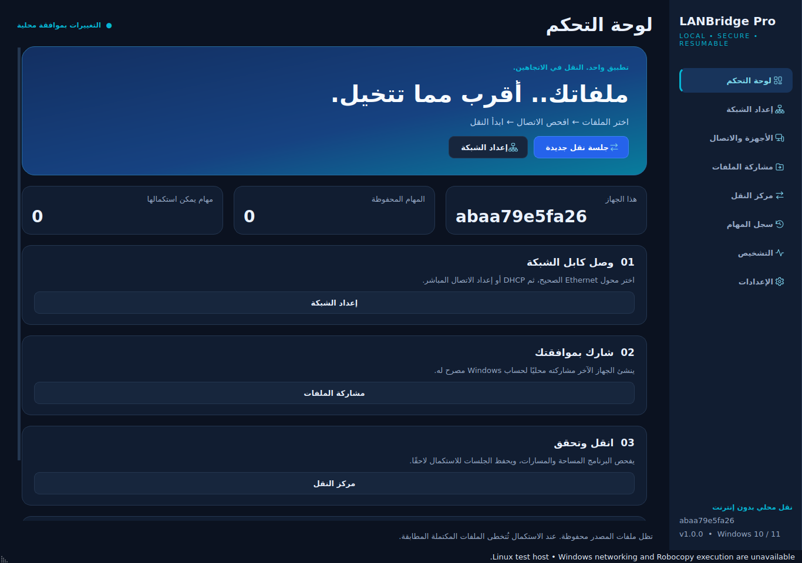

# LANBridge Pro 1.0.0

[English](README.md) · [دليل الاستخدام](docs/USER_GUIDE_AR.md) · [اختبارات GitHub Actions](https://github.com/AbdelrahmanOuf/LANBridge/actions)

تطبيق Windows Desktop لنقل الملفات عبر Ethernet وSMB، بواجهة Python 3.12 / PySide6.
نفس التطبيق ونفس حزمة التثبيت على الجهازين؛ المصدر والوجهة يحددان اتجاه النقل.

**حالة التسليم:** مشروع مصدر قابل للتشغيل مع اختبارات وبناء Windows. اختُبرت الطبقات المستقلة
والواجهة على Linux في بيئة الإنشاء. لم يُبنَ أو يُختبر ملف Windows EXE هنا، ولم تُختبر UAC أو
شبكة فعلية بين جهازين هنا. لا تُعتبر هذه الحزمة إصدارًا معتمدًا للإنتاج قبل اجتياز اختبارات
[Windows acceptance](docs/WINDOWS_ACCEPTANCE.md). النتائج الفعلية في [تقرير التحقق](docs/VALIDATION_REPORT.md).
هذا التقرير يسجل بيئة الإنشاء الأصلية؛ نتائج البناء والاختبارات الأحدث تظهر في GitHub Actions.



## التشغيل من المصدر على Windows

ثبّت **Python 3.12 x64** مع Python Launcher، وافتح PowerShell داخل المشروع:

```powershell
py -3.12 -m venv .venv
.\.venv\Scripts\python.exe -m pip install -r requirements.txt
.\.venv\Scripts\python.exe -m pip install --no-deps -e .
.\.venv\Scripts\python.exe -m lanbridge
```

أو استخدم `run.ps1`. لا تشغّل الواجهة كلها كمسؤول. وضع المصدر للتطوير على جهاز موثوق؛
للاستخدام الفعلي يُفضّل التثبيت المحمي الموضح أدناه. يلزم الإنترنت لتحميل الاعتمادات مرة واحدة
أو تجهيز wheelhouse؛ تشغيل التطبيق المبني والنقل لا يحتاجان إنترنت أو Python على الجهازين.

## البناء على Windows

```powershell
.\build.ps1
```

إذا كانت سياسة PowerShell المؤسسية تمنع تشغيل ملف السكربت، لا تغيّر السياسة لتجاوزها؛
استخدم أوامر التثبيت المصرح بها أو اطلب من المسؤول تنفيذ البناء. يمكن تنفيذ `build.py`
مباشرة بعد تثبيت `requirements-lock.txt` والمشروع.

البناء يشغّل pip check وRuff وPytest، ثم PyInstaller، ثم **ملف EXE الناتج نفسه** باختبار
نسخ محلي معزول بأسماء عربية، مجلد فارغ، SHA-256، وجلسة ثانية تتخطى الملفات المطابقة.
أي فشل يُفشل البناء. لا يستبدل ذلك اختبار الشبكة بين جهازين.

النواتج:

- `dist/LANBridgePro/LANBridgePro.exe` مع ملفات التشغيل التابعة له.
- `dist/LANBridgePro-Windows-x64.zip` للحزمة المحمولة؛ احتفظ بجميع محتوياتها.
- `dist/compiled-selftest.json` و`dist/build-report.json` وبصمة EXE.
- `dist/LANBridgePro-Setup.exe` إذا كان **Inno Setup 6.3+** مثبتًا.

يستخدم PyInstaller وضع **onedir**، ثم حزمة تثبيت واحدة للجهازين. هذا مقصود: العامل المرتفع
يعمل من تثبيت محمي داخل Program Files، وتبقى هوية العملية واضحة لقناة IPC. لا تنقل EXE وحده
من مجلده وتفترض أنه ملف standalone. نسخة Portable تدعم النقل والتشخيص؛ تغييرات UAC في النسخة
المجمعة تتطلب التثبيت داخل Program Files. التثبيت فقط يحتاج مسؤولًا؛ التشغيل اليومي asInvoker.
يجب مراجعة التوقيع الرقمي وSmartScreen واختبارات القبول قبل التوزيع التجاري؛ لم يُضف توقيع مزيف.

الاعتمادات مثبتة بإصدارات محددة في `requirements-lock.txt`. القابلية للتكرار هنا تعني نفس
الوصفة والإصدارات والاختبارات؛ ليست وعدًا ببصمة ثنائية متطابقة عبر أجهزة بناء مختلفة.

## أول نقل بين جهازين

1. افتح نفس التطبيق على A وB ووصل Ethernet مباشرًا أو عبر Switch/Router.
2. في Network Setup اختر كارت Ethernet الصحيح؛ راجع الاسم والوصف وMAC والسرعة.
3. عبر Router استخدم DHCP إن كان مناسبًا. في كابل مباشر اختر Quick PC A على جهاز
   وQuick PC B على الآخر: `192.168.50.1/24` و`192.168.50.2/24` بدون Gateway/DNS.
4. راجع المعاينة ووافق على التغيير المحلي وطلب UAC والتأكيد المستقل داخل العامل المرتفع.
   تعارض محلي/رد ARP إيجابي يمنع التغيير؛ عدم وجود رد لا يضمن خلو العنوان. يفحص Windows DAD
   العنوان بعد تعيينه، ويحاول التطبيق التراجع إلى Snapshot عند فشل التعيين.
5. على الجهاز **الذي يملك المجلد** أنشئ مشاركة لحساب Windows مصرح له. Read للمصدر؛
   Write اختياري إذا كانت المشاركة وجهة. NTFS منفصل ولا يُمنح تلقائيًا.
6. إذا كانت الشبكة موثوقة وتحتاج SMB، وافق محليًا على Private Profile ثم قاعدة TCP 445
   مقيدة بعنوان الجهاز المقابل وعلى نفس المحول. التطبيق لا يعطل Firewall ولا يفعّل SMB1.
7. على الجهاز الذي سيدير مهمة النسخ، أدخل UNC في Device Discovery واضغط Connect. استخدم
   `PC-B\user` أو `DOMAIN\user` وكلمة مرور الحساب، وليس Windows Hello PIN. يمكن تذكر الاعتماد
   في Windows Credential Manager. على الدومين يفضل اسم الجهاز الصحيح لدعم Kerberos؛ IP قد لا يُقبل.
8. اختر مصدرًا محليًا ووجهة UNC للإرسال، أو مصدر UNC ووجهة محلية للاستقبال. افحص المعاينة
   أو Dry Run، ثم وافق على بدء النسخ واستبدال الملفات المختلفة في الوجهة.

يمكن عكس الاتجاه بتغيير المصدر والوجهة من نفس البرنامج. التطبيق لا يختار ملفات جهاز آخر
أو يغير إعداداته عن بعد؛ الاستعراض والنقل يخضعان لجلسة SMB المصرح بها.

## الإيقاف اليوم والاستكمال غدًا

اضغط Pause safely وانتظر الحالة Paused، ثم أغلق التطبيق والجهازين. عند التشغيل التالي،
أعد الاتصال وتأكد من IP والمشاركة/الحساب والمسارات، ثم اختر المهمة من Transfer History
واضغط Resume selected. لا تحذف المصدر أو تغير بنية مجلداته بين الجلسات.

السياسة المنفذة هي **طلب CTRL+BREAK، انتظار خروج Robocopy، ثم تشغيل جديد بـ /Z**.
ليست تعليقًا لحظيًا لعملية Qt أو تجميدًا بخيط النقل. يوجد Force Stop بتأكيد منفصل عند تأخر
الخروج؛ قد يحتاج ملف جزئي لإعادة النسخ. إذا انهار التطبيق، يغلق Job Object عملية Robocopy
التابعة له، وتصبح المهام ذات الحالة النشطة Interrupted عند التشغيل التالي.

إعادة التشغيل تفحص الملفات الموجودة وتتخطى المتطابق بحسب قواعد Robocopy. الاستكمال من نفس
البايت ممكن للبيانات المؤهلة التي كتبها Robocopy في الوضع restartable، وليس لكل ملف جزئي
أنتجته أداة أخرى. فشل قراءة ملف/انقطاع الشبكة يبقى ظاهرًا في السجل ولا يُعلن نجاحًا لمجرد exit 1.

## دقة التقدم والتحقق

المحرك لا يحاول تفسير جدول Robocopy المترجم لحساب نسبة كلية وهمية مع MT.
أثناء النقل تُفحص عينة دورية محدودة من Manifest SQLite بمقارنة الاسم/الحجم/الوقت؛
الواجهة تعرض حجمًا مطابقًا **ملاحظًا وتقديريًا**. قد يتأخر المؤشر أو يتراجع إذا تغير ملف.
السجلات والعدادات لا تعني أن كل بايت وصل فعليًا إلى وسيط تخزين دائم.

- Current/Average speed وETA هي **معدل اكتمال الملفات المطابقة، تقديريًا**، وليست قياسًا
  دقيقًا لسرعة منفذ Ethernet أو البايتات الجارية داخل ملف ضخم.
- أثناء نسخ MT تعرض الواجهة نطاق العملية الحالي؛ أثناء التحقق تعرض ملف الدفعة الجاري.
  لا تدعي معرفة جميع الملفات التي ينسخها كل Thread في نفس اللحظة.
- Verified files لا يزيد إلا في التحقق النهائي. نجاح metadata لا يثبت تطابق المحتوى.
- خيار SHA-256 يقرأ النسختين بالكامل، ويكشف اختلاف المحتوى لكنه يزيد زمن القراءة/الشبكة.
- الملفات الجديدة/المعدلة أثناء الجلسة تمنع إعلان تحقق كامل ويُطلب Resume. لا يستخدم التطبيق
  VSS ولا يقدم نسخة لحظية لملفات برامج مفتوحة؛ أغلق البرامج التي تعدل المصدر أثناء النقل.

الأكواد `0..7` ليست فشل نقل تلقائيًا؛ `>=8` أخطاء. النتيجة النهائية تتطلب أيضًا اجتياز التحقق.
تبقى ملفات الوجهة الإضافية والمصدر محفوظة في Copy. الملفات المختلفة المشتركة في الاسم قد
تُستبدل بعد موافقة المستخدم؛ التطبيق ليس نظام نسخ احتياطية يحتفظ بإصداراتها السابقة.

## المشاركة والأمان

الأسماء الفريدة `LANBridge_…` مع وصف ownership محفوظ. يحذف التطبيق فقط مشاركاته التي
لها Snapshot محلي مطابق؛ لا يحذف C$ أو مشاركات Windows أو يعيد ضبط ACL عام.
مشاركة ملف منفرد عبر SMB تعني مشاركة **المجلد الحاوي**؛ قد يرى الحساب بقية الملفات المسموح بها.

Share Permissions وNTFS ACL طبقتان منفصلتان. إضافة NTFS اختيار صريح يضيف Allow على المجلد
مع وراثة للمحتويات التي تسمح بالوراثة؛ لا يكسر Deny أو الوراثة المحمية. يُحفظ DACL للمجلد
قبل وبعد، ويُرفض استبداله إن رُصد تعديل خارجي. هذا ليس Snapshot مستقلًا لكل ACL في شجرة ضخمة.

لا توجد قناة تحكم عن بعد، ولا Guest تلقائي، ولا تعطيل SMB Signing، ولا كلمات مرور في SQLite
أو argv أو logs. Secret يُرسل إلى Win32 WNet/Credential Manager داخل العملية. كلمات المرور
تبقى مؤقتًا في ذاكرة Python أثناء المصادقة؛ حذف المرجع ليس ضمان محو آمن للـRAM.
لا تُرسل كلمات المرور عبر Discovery. الإعلان اختياري ومغلق افتراضيًا؛ UDP 47623 يحتوي اسم الجهاز
ومعرفًا وتحديًا فقط ويُعرض كإعلان غير موثّق، ولا يمنح صلاحيات. QR/Pairing ليس شرطًا للنقل
ولم يُضف كطبقة مصادقة بديلة عن SMB.

يفحص التطبيق المسارات والعناصر الموجودة ويستبعد Reparse/Junction/Symlink، ويمنع التداخل
المباشر وملفات بياناته داخل شجرة النسخ. لا تعدل Share mappings أو Junctions أو المسارات أثناء
المهمة، ولا تستخدم أسماء SMB بديلة متعددة لنفس الشجرة. حماية الملفات من مهاجم محلي يغير
المجلدات بالتزامن تتطلب سياسات NTFS وحسابات Windows المناسبة؛ الفحص ليس عزلًا لنظام الملفات.

## النقل النهائي Move

Copy هو الوضع الطبيعي. الإجراء المنفصل Verified move cleanup في السجل يتطلب نجاح SHA-256
سابقًا وكتابة `DELETE VERIFIED SOURCES`. يفتح النسختين بمقابض Windows تمنع الكتابة/الحذف
المتزامن، ويعيد SHA-256، ثم يحذف ملف المصدر **بالمقبض نفسه**. يعمل فقط على المصدر المحلي
وعلى جهاز مالكه؛ المجلدات الفارغة تُترك. إذا فشل ملف يتوقف التنظيف وتبقى الملفات الأخرى،
وتسجل الملفات المحذوفة بوضوح. لا توجد استعادة حذف تلقائية ولا تكرار آلي لهذا الإجراء بعد الإقلاع.

## التصميم وشجرة المشروع

| الطبقة | المسار | مسؤوليتها |
|---|---|---|
| الواجهة | `src/lanbridge/ui/` | 8 صفحات، RTL/LTR، Dark/Light، معاينات، workers وإشارات Qt |
| قواعد التطبيق | `services/application.py` | تنسيق الخدمات وقفل التغييرات أثناء المهام |
| البيانات والنماذج | `core/` | Dataclasses، حالات المهام، WAL، migrations، عدادات transactional |
| Windows Adapter | `platform/powershell.py` + `resources/windows.ps1` | Dispatcher ثابت وJSON منفصل عن كود الأوامر |
| الشبكة | `network/` | IP/Subnet، ARP، Discovery محدود، تشخيص مستقل لكل مرحلة |
| الأمان | `security/` | UAC per action، pipe محلي ACL/PID/nonce، Credentials Manager |
| النقل | `transfer/` | Manifest متدفق، Robocopy Job، إيقاف/استكمال، metadata/SHA، تنظيف اختياري |
| الاختبارات | `tests/unit/` و`tests/integration/` | اختبارات مستقلة وMock وWindows/LAN opt-in |
| التغليف | `packaging/`, `build.py`, `build.ps1` | EXE asInvoker، manifest، ICO، Inno installer واختبار EXE |

الشجرة الكاملة القابلة للتصفح في [PROJECT_TREE.md](docs/PROJECT_TREE.md).
تفاصيل تدفق العمليات ونموذج التهديد في [ARCHITECTURE.md](docs/ARCHITECTURE.md).

## الاختبارات

```powershell
.\.venv-build\Scripts\python.exe -m pytest -q
.\.venv-build\Scripts\python.exe -m ruff check src tests tools build.py
```

اختبارات LAN لا تعمل إلا بعد توفير متغيرات بيئة لمسارات مختبر مخصصة ومشاركة مصرح بها؛
انظر دليل القبول. لا يغير Pytest تلقائيًا IP أو Firewall على جهاز عمل. حالات الدومين والكابل
والإغلاق الفعلي لها خطوات قبول صريحة، ولم تُعتبر ناجحة بالـMocks.

## حدود ونقاط تشغيل

- ملفات المستخدم فقط؛ لا يرحّل Windows أو تثبيت البرامج أو السجل أو التراخيص أو EFS keys.
- Windows 10/11 x64، Ethernet/SMB حديث، مع السياسات والتحديثات المناسبة للمؤسسة.
- تحفظ البيانات في `%LOCALAPPDATA%\LANBridgePro` والتقارير في `logs` خارجهما.
- إذا كان المجلد المختار يحتوي بيانات التطبيق نفسها، اختر مجلدات فرعية مستقلة؛ لا تنسخ قرص
  Windows كاملًا بهذه الأداة. لا تستخدم المصدر/الوجهة لتخزين قاعدة مهام التطبيق أو Logs.
- مسارات Unicode مدعومة. المسارات الطويلة تتطلب دعم Windows والسياسة ونظام الملفات؛
  manifest لا يتجاوز سياسة المؤسسة. الروابط والـADS وأسماء الأجهزة ليست مصادر مسموحة.
- FAT32 يمنع الملفات الأكبر من `2^32 - 1` bytes. FAT/exFAT يتطلبان /FFT ويخسران بعض خصائص NTFS.
- /IORATE اختياري؛ يفحص المحرك توفره في نسخة Robocopy ويمنع البدء بحد سرعة غير مدعوم.
- لغة الواجهة تتغير بعد إعادة التشغيل؛ الثيم يتغير فورًا. الرسائل التقنية وبعض تفاصيل النظام
  تبقى بالإنجليزية، مع إرشادات عربية، للحفاظ على أسماء الخيارات والأخطاء الأصلية.
- استعادة DHCP تعيد نمط DHCP/DNS، ولا تعد بإعادة نفس العنوان الذي منحه DHCP سابقًا.
- التشخيص لا ينسب فشل TCP إلى Firewall بصورة قطعية، ولا يعتبر فشل Ping وحده انقطاعًا.
- قبل اعتماد الإنتاج: اختبر UAC والـrollback والبناء المجمّع والشبكة/السياسات على بيئتك، ووقّع الحزمة.

## المراجع الرسمية

تنفيذ Windows يعتمد على [Robocopy](https://learn.microsoft.com/en-us/windows-server/administration/windows-commands/robocopy)،
[New-SmbShare](https://learn.microsoft.com/en-us/powershell/module/smbshare/new-smbshare)،
[SMB signing](https://learn.microsoft.com/en-us/windows-server/storage/file-server/smb-signing)،
[WNetAddConnection2W](https://learn.microsoft.com/en-us/windows/win32/api/winnetwk/nf-winnetwk-wnetaddconnection2w)،
[CredWriteW](https://learn.microsoft.com/en-us/windows/win32/api/wincred/nf-wincred-credwritew)،
[Console control events](https://learn.microsoft.com/en-us/windows/console/generateconsolectrlevent).
