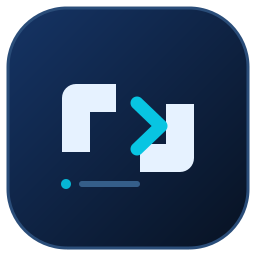
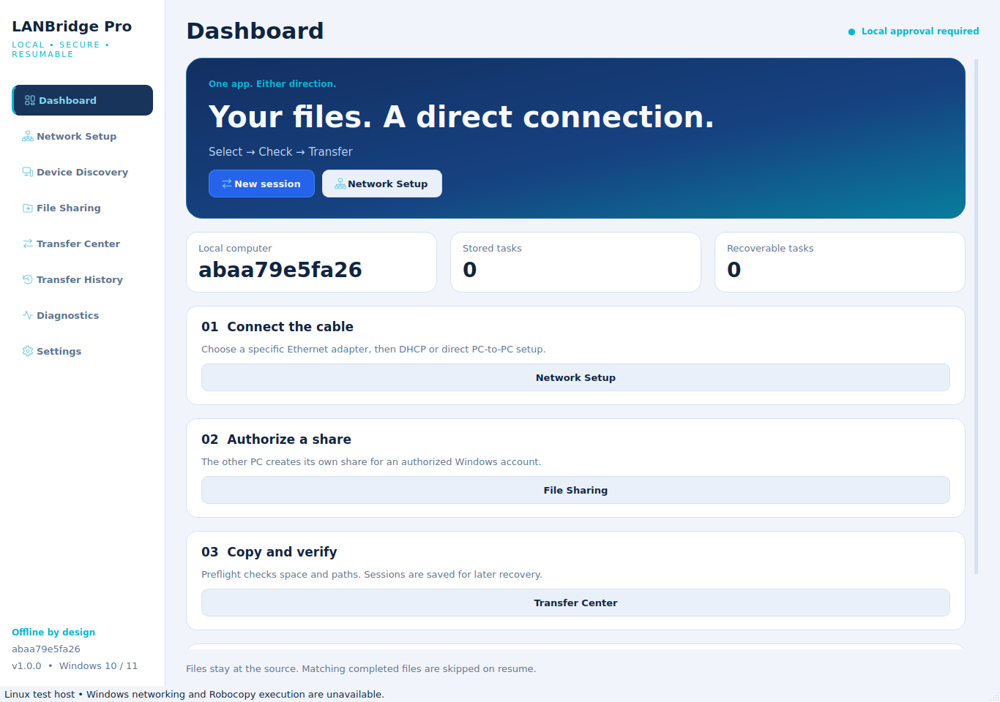

<div align="center">



# LANBridge Pro

### Windows LAN file transfer over Ethernet — with resumable Robocopy sessions

Copy files between two PCs, configure local IPv4, authorize SMB shares, and resume saved tasks after restarting both computers.

[](https://github.com/AbdelrahmanOuf/LANBridge/actions/workflows/ci.yml)
[](https://github.com/AbdelrahmanOuf/LANBridge/actions/workflows/build-windows.yml)


**English** · [العربية](README.ar.md) · [دليل الاستخدام العربي](docs/USER_GUIDE_AR.md)

</div>



## What is LANBridge?

LANBridge Pro is a Python / PySide6 Windows desktop tool for **PC-to-PC file transfers over Ethernet LAN**.
It brings local network setup, Windows file sharing and Robocopy into one interface. The same application
runs on both PCs; either can send or receive. Transfers work on an offline LAN through a direct Ethernet
cable, switch or router. Runtime does not require internet or a cloud account.

Use it to copy documents, photos, videos, projects and large file collections from an old PC to a new PC.
It copies user files; it does not migrate Windows, installed programs, registry settings or application licenses.

**Status: development preview.** Local unit, Mock and offscreen UI results are in
[VALIDATION_REPORT.md](docs/VALIDATION_REPORT.md). Workflow badges show live CI state. GitHub Actions runs
portable checks and builds/tests the Windows executable on an isolated runner. Passing CI does not certify
real two-PC transfers, UAC changes, domain policies or shutdown recovery. Those require the
[Windows acceptance matrix](docs/WINDOWS_ACCEPTANCE.md).

## Features

| Area | Implemented behavior |
|---|---|
| One app, either direction | Local → authorized remote SMB share, or remote share → local folder |
| Ethernet / IPv4 | Adapter name, MAC, link status/speed, IP, DHCP, gateway and DNS; manual/DHCP/direct-cable presets |
| Local approval | Per-action UAC helper, preview and saved rollback snapshots; no remote administration channel |
| Windows sharing | App-owned SMB shares, Read default, optional Write/NTFS changes, peer-scoped Private firewall rule |
| Authentication | Current Windows session or authorized account; optional Windows Credential Manager storage |
| Large transfers | Robocopy `/E /Z /R:2 /W:2 /MT:8 /XJ`; 1–128 threads; no default `/MIR`, `/PURGE` or `/MOVE` |
| Stop and resume | Request stop, wait for process exit, persist in SQLite, recheck and relaunch with `/Z` |
| Integrity | Preflight, dry run, metadata verification, optional SHA-256 and failed-file retry |
| Diagnostics | Separate link, subnet, Ping, TCP 445, share, credentials and Windows-policy checks |
| Interface | Arabic RTL / English LTR, dark/light themes, history, Unicode logs and estimated activity chart |

## Get started on Windows

Requires **Windows 10/11 x64** and **Python 3.12 x64** for source execution. A built Windows bundle includes
Python and dependencies. Fetch build dependencies once, or prepare an offline wheelhouse; actual transfers use LAN only.

```powershell
git clone https://github.com/AbdelrahmanOuf/LANBridge.git
cd LANBridge
py -3.12 -m venv .venv
.\.venv\Scripts\python.exe -m pip install -r requirements.txt
.\.venv\Scripts\python.exe -m pip install --no-deps -e .
.\.venv\Scripts\python.exe -m lanbridge
```

For double-click startup, extract the source ZIP completely, then open **`run.cmd`** inside the project
folder. It starts the adjacent `run.ps1` with Windows PowerShell, prepares `.venv` on first use and keeps
the console open if startup fails. Install Python 3.12 x64 with the Python Launcher first; first-time
setup downloads dependencies. Do not try to run files from inside the ZIP.

Opening `run.ps1` directly can open Notepad because `.ps1` is a PowerShell script. To execute it from
CMD or PowerShell inside the extracted project folder, use:

```bat
powershell.exe -NoProfile -ExecutionPolicy Bypass -File ".\run.ps1"
```

The launcher uses a process-only execution policy; it does not save a system/user policy change, and
Group Policy still takes precedence. Start normally; UAC is requested only for approved local system changes.
Do not weaken corporate PowerShell or SMB policy to run the app; contact your administrator if needed.

### First transfer

1. Connect both PCs through Ethernet, a switch or router. Open the same app on both.
2. Select the correct Ethernet adapter. Use DHCP on a suitable router LAN, or Quick PC A / Quick PC B for
   a direct link: `192.168.50.1/24` and `192.168.50.2/24`, with no gateway/DNS when unnecessary.
3. On the PC owning the folder, create an SMB share for an authorized Windows account. Read is enough for
   a source; allow Write only for a receiving share. Share permissions and NTFS ACLs remain separate.
4. If needed, locally approve a Private profile and TCP 445 rule restricted to the peer IP.
5. Enter the UNC share in Device Discovery, connect using `PC-NAME\user` or `DOMAIN\user`, choose source
   and destination in Transfer Center, then review preflight / dry run before copying.

The other PC's user approves its own sharing/settings. Discovery grants no access. SMB signing is preserved;
the app does not activate SMB1, insecure guests or passwordless policy bypasses.

### Stop today, resume tomorrow

Choose **Pause safely**, wait for **Paused**, then close the app and shut down both PCs. Next time, restore
Ethernet/SMB connectivity, select the task in **Transfer History** and choose **Resume selected**. Saved
credentials are reused when available; matching completed files are skipped.

This is stop-and-relaunch, not instant process suspension. `/Z` may resume eligible Robocopy-written partial
data; a partial file produced by another tool may need a full recopy. After unexpected restart, recheck and
final verification are still required. Copy retains source files and completed destination copies.

### Progress and data integrity

- During MT copies, progress/speed are **estimates from observed matching files**, not precise byte-level
  Ethernet measurements. A large file may finish before the estimate moves.
- Final metadata checks compare size/time; optional SHA-256 reads both copies and checks content at extra cost.
- Destination-only files remain. Existing differing files with the same name may be overwritten after confirmation.
- Copy is the normal workflow. Separate explicitly confirmed verified cleanup is available after a successful
  SHA-256 task, on the local source-owning PC only. It leaves source directories and never runs automatically.

## Build the Windows application

Build **on Windows x64**; the Windows application is not cross-built from Linux:

```powershell
.\build.ps1
```

The script installs pinned dependencies, checks/lints/tests, builds `LANBridgePro.exe`, then executes the
**actual frozen EXE** against isolated temporary files. A failed self-test fails the build.

| Output | Purpose |
|---|---|
| `dist/LANBridgePro/LANBridgePro.exe` | Application and required companion files |
| `dist/LANBridgePro-Windows-x64.zip` | Portable bundle; keep the whole folder |
| `dist/compiled-selftest.json` | Actual frozen-application test evidence |
| `dist/build-report.json` | Build environment, EXE hash, self-test and acceptance limits |
| `dist/LANBridgePro-Setup.exe` | Installer when Inno Setup 6.3+ is installed |

PyInstaller uses **onedir**, with an optional single installer for both PCs. Frozen privileged actions
require a protected **Program Files** installation. Portable mode supports transfers/diagnostics. Unsigned
CI artifacts are development previews, not audited or signed production releases.

The [Windows workflow](https://github.com/AbdelrahmanOuf/LANBridge/actions/workflows/build-windows.yml)
uploads tested development bundles and logs as Actions artifacts. For offline dependency preparation, see
`tools/download_wheels.ps1`.

## Architecture and documentation

| Package | Responsibility |
|---|---|
| `ui/` | PySide6 pages, styles, translation and queued background signals |
| `services/` | Application coordination and exclusive operation lock |
| `core/` | Typed models, validation, logging, SQLite WAL/migrations/checkpoints |
| `platform/` | Trusted Windows paths and fixed PowerShell dispatcher adapter |
| `network/` | IPv4/subnet/ARP checks, bounded opt-in discovery and diagnostics |
| `security/` | Local ACL/PID/nonce protected UAC IPC and Windows credential APIs |
| `transfer/` | Streamed manifest, supervised Robocopy Job Object, verification and recovery |

[Full architecture](docs/ARCHITECTURE.md) · [Project tree](docs/PROJECT_TREE.md) ·
[Arabic user guide](docs/USER_GUIDE_AR.md) · [Windows acceptance plan](docs/WINDOWS_ACCEPTANCE.md)

## Development

```powershell
py -3.12 -m venv .venv-dev
.\.venv-dev\Scripts\python.exe -m pip install -r requirements-lock.txt
.\.venv-dev\Scripts\python.exe -m pip install --no-build-isolation --no-deps -e .
.\.venv-dev\Scripts\python.exe -m ruff check src tests tools build.py
.\.venv-dev\Scripts\python.exe -m pytest -q -m "not lan"
```

Two-PC tests are opt-in and use dedicated authorized fixtures. They do not silently reconfigure adapters,
security policies or existing shares. Read [CONTRIBUTING.md](CONTRIBUTING.md) and [SECURITY.md](SECURITY.md).

## FAQ

**Without internet?** Yes, runtime transfers use LAN. Dependency installation is a separate one-time step.

**Same installer on old and new PCs?** Yes; source/destination selection determines direction.

**Installed applications or Windows?** No; only selected user files and folders.

**Why not remove password protection?** Authorized Windows accounts and optional secure credential storage
provide access without weakening SMB signing or guest policy.

**Failed Ping?** ICMP may be blocked while TCP 445 / SMB work; diagnostics separate these checks.

**Filesystems?** NTFS is the main target. FAT/exFAT have metadata/timestamp limitations; FAT32 limits a single
file to `2^32 - 1` bytes. Long paths depend on Windows policy and filesystem support.

## Project status and licensing

A project-wide redistribution license has not yet been selected by the maintainer. Third-party components
retain their own licenses; see [NOTICE.md](NOTICE.md). Review dependency notices before distributing a build.

## بالعربية

**LANBridge Pro** أداة Windows لنقل الملفات بين جهازين عبر كابل Ethernet أو الشبكة المحلية، مع إعداد
IPv4 ومشاركة SMB وحفظ المهام واستكمال النسخ بعد إغلاق الجهازين. نفس التطبيق يعمل على الطرفين.
اقرأ [الشرح العربي الكامل](README.ar.md) و[دليل الاستخدام](docs/USER_GUIDE_AR.md).
