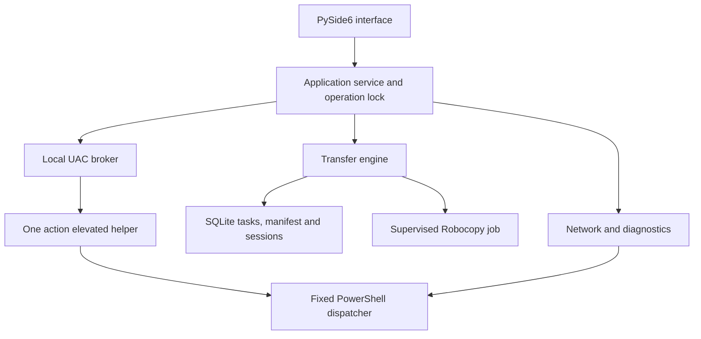

# Architecture and operational contracts

## Components

UI has no privileged cmdlets and never performs the copy in its event thread. QRunnable
workers emit signals through QObject instances created on the GUI thread. Tests verify the
receiving thread. Each persistent operation opens its own short SQLite connection, with WAL,
foreign keys, FULL synchronous boundaries and migrations via user_version.

## Normal transfer

1. Validate literal absolute paths, no traversal/device names/ADS, existing ancestors and reparse points.
2. Derive copy roots for each folder/file. Folder itself appends the source name; contents mode merges
   selected folder contents. Conservative casefold collisions stop a merge rather than overwrite a
   second selected source accidentally. File selection passes one literal filename to Robocopy.
3. Inventory source entries in bounded batches into SQLite. Check read access, exclusive locks, type
   collisions, filesystem limits, writable destination anchor, free capacity and extra destination entries.
4. Show source-by-source sizes/counts and overwrite policy. Dry run uses /L with a separate Unicode log.
5. Create Robocopy suspended with a hidden isolated console, assign a KILL_ON_JOB_CLOSE Job, then resume.
   Argument vector is serialized with Windows list2cmdline for CreateProcess; there is no cmd.exe or shell=True.
6. Periodically observe at most 256 manifest entries. SQLite triggers maintain exact counters of the
   observed/verified statuses without rescanning a million-row table for each GUI update.
7. Exit codes and final metadata/SHA-256 checks jointly determine task success. Detect source drift.

The manifest is a session inventory, not a VSS snapshot. Root path checks and /XJ exclusions prevent
ordinary loop mistakes; another actor changing directory aliases/reparse points during a transfer remains
outside this file-copy tool's isolation guarantees. Existing files with differing content can be replaced.

## Recovery contract

Running/scanning/verifying/stopping states become interrupted after an application restart. Session rows
that never ended are closed with an interrupted note. A resumed task rebuilds the inventory and reruns
Robocopy /Z. Matching files remain, and Robocopy decides whether its own partial data is restartable.
No percent checkpoint is treated as proof that bytes are durable. A stop signal is CTRL+BREAK plus waiting
for process exit. Force termination is explicit; after power loss there is no graceful-stop claim.

## Privilege boundary

Each local change has one short-lived elevated helper. The installed GUI remains asInvoker. A local named
pipe has a restrictive user/admin/system DACL, rejects remote clients, uses an unpredictable name and nonce,
and validates the client PID against the launched process. The helper validates the server PID and a bounded
JSON allowlist, shows its own authoritative confirmation, captures a preimage, then waits for an ACK after
the parent commits that preimage to SQLite. It does not mutate the system if the parent disconnects before ACK.

The helper can perform only network IP/profile, app-owned share/NTFS and app-owned scoped firewall changes.
It cannot execute arbitrary commands, accept scripts over the pipe, change credentials, disable signing,
activate guests or run remote commands. The fixed dispatcher is shipped code; all plan data is JSON stdin.
Administrative operations are serialized against active transfers at the application service boundary.

The frozen application restricts privileged actions to a Program Files installation. The default onedir
package plus Inno installer avoids relying on a writable portable code directory for elevated imports and
provides one native worker PID. Source execution is a development trust model. Before commercial release,
the installer/executable must be signed and installation ACLs and your endpoint policy must be reviewed.

## Rollback scope

| Change | Saved preimage | Restoration |
|---|---|---|
| IPv4 | Adapter GUID/index, manual addresses, default routes/metrics, DHCP, DNS values/mode | Reapplies configuration to that GUID only; DHCP can issue another lease |
| Private profile | Previous network category | Restores only Public/Private; DomainAuthenticated is never overwritten |
| New share | Original root DACL, account SID, marker/name/path, result DACL | Removes only app-owned share; restores root DACL if it still matches expected post-state |
| Firewall allow | Unique app rule marker and peer/interface | Removes that rule only; no global profile reset |

IPv4 apply failure attempts automatic rollback. Root ACL additions followed by share-creation failure
attempt local ACL rollback inside the dispatcher. A crash can leave a prepared operation; inspect it before
retrying. An incomplete share outcome does not authorize blindly restoring every descendant ACL. There is
no general rollback for overwriting a destination file or deleting explicitly verified source files.

## Credentials and discovery

SMB uses the current Windows session or app credentials stored with CredWrite/CredRead (generic target per
server). WNetAddConnection2 receives secrets in process. No passwords are stored in task specs, argv, logs,
discovery packets or exported diagnostics. Saved credentials are not automatically deleted when a task ends.
Forgetting a credential does not disconnect unrelated Windows sessions; error 1219 is explained instead.

Discovery is opt-in UDP broadcast with version, bounded message size, a challenge, subnet filtering and a
small per-peer rate cache. It is an unverified advertisement, not a pairing/authentication/control protocol.
It reveals no paths/shares and does not bypass SMB. The account on the folder-owning PC is the authority.

## Boundedness and testing

The main inventory and counters remain in SQLite, copies run sequentially per root with MT inside Robocopy,
and final verification reads large files in 4 MiB chunks. Failed-file-only retries deliberately use one literal
file command each, keeping argv bounded at the cost of process overhead for many failures. Full Resume is
preferable for a large retry batch. Unit tests use injectable runners/PS adapters and real temporary metadata
verification; Windows tests are separately marked, and policy/cable/shutdown acceptance remains a real-VM gate.
